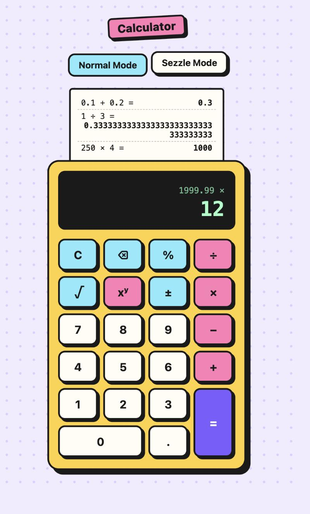
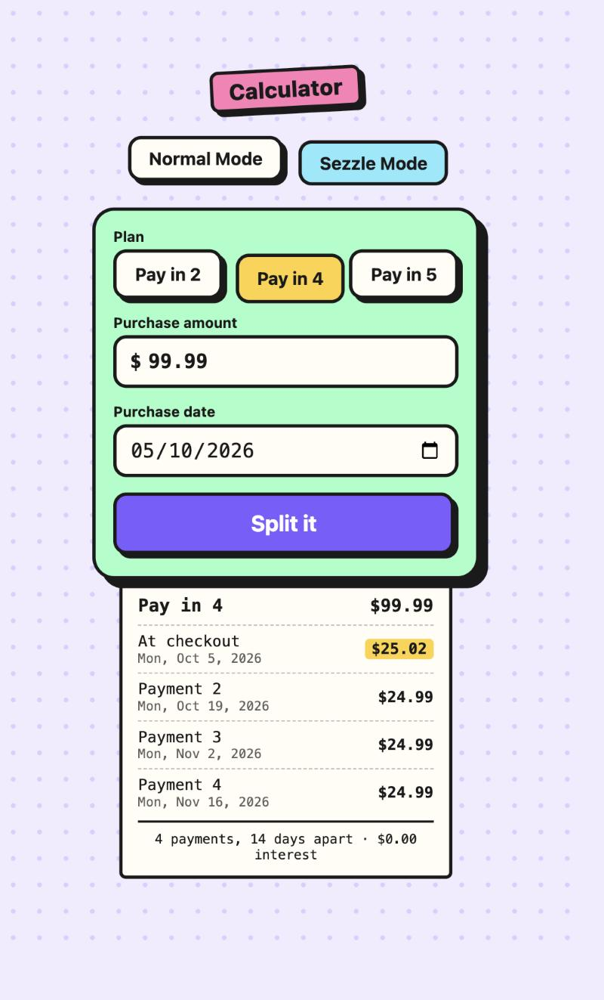

# Full-Stack Calculator

A calculator with a **React + TypeScript** frontend and a **Go** REST API. The
UI never does arithmetic itself: every operation is sent to the backend.

It has two tools, on two tabs:

- **Normal Mode.** A calculator: addition, subtraction, multiplication, division,
  exponentiation, square root and percentage, with exact decimal arithmetic.
  Each result is printed on a paper tape above the keypad; picking a line
  brings that result back to reuse it.
- **Sezzle Mode.** A "buy now, pay later" planner modelled on Sezzle's
  interest-free plans (Pay in 2, Pay in 4, Pay in 5): it splits a purchase into
  installments two weeks apart, exact to the cent.

<p align="center">
  
  &nbsp;&nbsp;
  
</p>

**Contents:** [Setup](#setup) · [API](#api) · [Tests and coverage](#tests-and-coverage) ·
[Design decisions](#design-decisions) · [Assumptions](#assumptions) ·
[Edge cases](#edge-cases) · [With more time](#with-more-time) · [AI usage](#ai-usage)

## Project structure

```
.
├── backend/                Go service
│   ├── cmd/server/         entry point: wires storage, service and HTTP server
│   └── internal/
│       ├── calculator/     domain: exact decimal arithmetic, as pure functions
│       ├── paymentplan/    domain: splitting a purchase into installments, in integer cents
│       ├── history/        use case: calculate and record; defines the Repository interface
│       ├── storage/memory/ in-memory implementation of that interface
│       └── api/            REST layer: routing, validation, error mapping, OpenAPI docs
├── frontend/               React app (Vite, TypeScript, Vitest)
│   └── src/
│       ├── api/            typed client for the backend
│       ├── calculator/     keypad state machine (reducer) + hook that calls the API
│       ├── payments/       amount validation and money/date formatting
│       └── components/     the calculator, its history tape and the payment planner
├── Dockerfile              one image that serves the API and the built UI
└── Makefile                shortcuts for every command below
```

Dependencies point inwards: `api` → `history` → `calculator`, and `api` →
`paymentplan`. Nothing in the two domain packages knows about HTTP, JSON or
where records are stored.

## Setup

Prerequisites: **Go 1.22+** and **Node.js 20+** (or just Docker).

```bash
make install     # install frontend dependencies
```

### Run in development

Use two terminals:

```bash
make backend     # API on http://localhost:8080
```

```bash
make frontend    # UI on http://localhost:5173
```

Open <http://localhost:5173>. The Vite dev server proxies `/api` to the backend,
so there is nothing else to configure.

| URL                           | What it is                                      |
| ----------------------------- | ----------------------------------------------- |
| <http://localhost:5173>       | The app, with both modes                        |
| <http://localhost:8080/docs>  | API documentation (Swagger UI)                  |
| <http://localhost:8080>       | The API only; the root redirects to `/docs`     |

Without `make`: `cd backend && go run ./cmd/server` and
`cd frontend && npm install && npm run dev`.

### Run with Docker

```bash
make docker      # docker build -t calculator . && docker run --rm -p 8080:8080 calculator
```

Open <http://localhost:8080>. A single container serves both the UI and the API.

### Configuration

| Variable     | Default | Purpose                                                    |
| ------------ | ------- | ---------------------------------------------------------- |
| `PORT`       | `8080`  | Port the backend listens on                                |
| `STATIC_DIR` | _unset_ | Directory with the built frontend to serve at `/` (Docker) |

## API

Interactive documentation (Swagger UI) is served by the backend at
**<http://localhost:8080/docs>**; the OpenAPI document itself is at
`/api/v1/openapi.yaml`.

| Method | Path                         | Description                                  |
| ------ | ---------------------------- | -------------------------------------------- |
| `POST` | `/api/v1/calculations`       | Perform a calculation and record it          |
| `GET`  | `/api/v1/calculations`       | List the history, newest first (paginated)   |
| `GET`  | `/api/v1/calculations/{id}`  | Get one recorded calculation                 |
| `POST` | `/api/v1/payment-plans`      | Split a purchase into installments           |
| `GET`  | `/api/v1/operations`         | List the supported operations                |
| `GET`  | `/healthz`                   | Health check                                 |

### `POST /api/v1/calculations`

| Field       | Type   | Notes                                                                           |
| ----------- | ------ | ------------------------------------------------------------------------------- |
| `operation` | string | `add`, `subtract`, `multiply`, `divide`, `power`, `sqrt`, `percentage`          |
| `a`         | string | First operand, a decimal number sent as a string: `"12.5"`                      |
| `b`         | string | Second operand. Required for everything except `sqrt` (unary), which rejects it |

Numbers travel as **strings**, in requests and responses, with up to 34
significant digits (`"0.1"`, `"-12.50"`, `"1.5E+3"`). A JSON number such as
`0.1` is rejected: see "Decimal arithmetic" under [Design decisions](#design-decisions).

The request must be sent with `Content-Type: application/json`.
`percentage` returns `a` percent of `b` (`20`, `150` → `30`). A successful
calculation returns `201 Created` with the stored record and a `Location`
header. Failed calculations are not recorded.

```bash
curl -X POST http://localhost:8080/api/v1/calculations \
  -H 'Content-Type: application/json' \
  -d '{"operation": "add", "a": "0.1", "b": "0.2"}'
# 201 {"id":1,"operation":"add","a":"0.1","b":"0.2","result":"0.3","createdAt":"2026-10-05T21:30:00Z"}

curl -X POST http://localhost:8080/api/v1/calculations \
  -H 'Content-Type: application/json' \
  -d '{"operation": "sqrt", "a": "81"}'
# 201 {"id":2,"operation":"sqrt","a":"81","result":"9","createdAt":"2026-10-05T21:30:05Z"}

curl -X POST http://localhost:8080/api/v1/calculations \
  -H 'Content-Type: application/json' \
  -d '{"operation": "divide", "a": "1", "b": "3"}'
# 201 {"id":3,"operation":"divide","a":"1","b":"3","result":"0.3333333333333333333333333333333333","createdAt":"..."}

curl -X POST http://localhost:8080/api/v1/calculations \
  -H 'Content-Type: application/json' \
  -d '{"operation": "divide", "a": "1", "b": "0"}'
# 422 {"error":{"code":"division_by_zero","message":"division by zero"}}

curl -X POST http://localhost:8080/api/v1/calculations \
  -H 'Content-Type: application/json' \
  -d '{"operation": "add", "a": "1"}'
# 400 {"error":{"code":"invalid_request","message":"field \"b\" is required"}}
```

### `GET /api/v1/calculations`

| Query    | Default | Notes                                                    |
| -------- | ------- | -------------------------------------------------------- |
| `limit`  | `20`    | Page size, 1 to 100                                      |
| `cursor` | _none_  | The `nextCursor` of the previous page; omit for the first |

```bash
curl 'http://localhost:8080/api/v1/calculations?limit=1'
# 200 {"calculations":[{"id":3,"operation":"divide","a":"1","b":"3","result":"0.3333333333333333333333333333333333","createdAt":"..."}],"nextCursor":"3"}

curl 'http://localhost:8080/api/v1/calculations?limit=1&cursor=3'
# 200 {"calculations":[{"id":2,"operation":"sqrt","a":"81","result":"9","createdAt":"..."}],"nextCursor":"2"}

curl http://localhost:8080/api/v1/calculations/1
# 200 {"id":1,"operation":"add","a":"0.1","b":"0.2","result":"0.3","createdAt":"..."}
```

`nextCursor` is absent on the last page.

### `POST /api/v1/payment-plans`

| Field          | Type   | Notes                                                        |
| -------------- | ------ | ------------------------------------------------------------ |
| `plan`         | string | `pay_in_2`, `pay_in_4` or `pay_in_5`                         |
| `amount`       | string | Dollars with at most two decimals: `"99.99"`, `"100"`        |
| `purchaseDate` | string | `YYYY-MM-DD`; the first installment is charged on this day   |

Nothing is stored: the same request always returns the same schedule.

```bash
curl -X POST http://localhost:8080/api/v1/payment-plans \
  -H 'Content-Type: application/json' \
  -d '{"plan": "pay_in_4", "amount": "99.99", "purchaseDate": "2026-10-05"}'
```

```json
{
  "plan": "pay_in_4",
  "amount": "99.99",
  "currency": "USD",
  "interest": "0.00",
  "intervalDays": 14,
  "installments": [
    { "number": 1, "dueDate": "2026-10-05", "amount": "25.02" },
    { "number": 2, "dueDate": "2026-10-19", "amount": "24.99" },
    { "number": 3, "dueDate": "2026-11-02", "amount": "24.99" },
    { "number": 4, "dueDate": "2026-11-16", "amount": "24.99" }
  ]
}
```

### Errors

Every error has the same shape: `{"error": {"code": "...", "message": "..."}}`.
`code` is stable and meant for programs; `message` is meant for people.

| Status | Code                   | When                                                               |
| ------ | ---------------------- | ------------------------------------------------------------------ |
| 400    | `invalid_request`      | Invalid JSON; missing, duplicated or unknown field; operand that is not a decimal string or has over 34 significant digits; `b` sent to a unary operation; amount that is not dollars with at most two decimals; date that is not `YYYY-MM-DD`; bad `limit` or `cursor` |
| 400    | `unknown_operation`    | `operation` is not one of the supported values                     |
| 400    | `unknown_plan`         | `plan` is not one of the supported values                          |
| 404    | `not_found`            | No calculation has that ID, or the endpoint does not exist         |
| 405    | `method_not_allowed`   | The endpoint exists but not for that method (history is append-only) |
| 413    | `request_too_large`    | Body larger than 1 KB                                              |
| 415    | `unsupported_media_type` | `Content-Type` is not `application/json`                         |
| 422    | `division_by_zero`     | Dividing by zero, or `0` raised to a negative power                |
| 422    | `negative_square_root` | Square root of a negative number                                   |
| 422    | `undefined_result`     | No real result, e.g. a negative base with a fractional exponent    |
| 422    | `result_out_of_range`  | The result is above about 10^6144, or closer to zero than 10^-6143 |
| 422    | `amount_out_of_range`  | The amount has fewer cents than the plan has installments, or exceeds 1,000,000.00 |
| 500    | `internal_error`       | Unexpected failure; details are logged, not returned               |

## Tests and coverage

```bash
make test        # go vet + go test, tsc + vitest
make coverage    # same, plus coverage reports
```

`make coverage` prints a summary and writes HTML reports to
`backend/coverage.html` and `frontend/coverage/index.html`.

| Layer    | Tests                                                               | Statement coverage |
| -------- | ------------------------------------------------------------------- | ------------------ |
| Backend  | Table-driven unit tests for domain, service, storage and HTTP layer, plus fuzz tests | 100% of `internal/` |
| Frontend | 188 tests: reducer, input validation, API clients, and both tools end to end | 100% of lines |

The domain also has fuzz tests (`make fuzz`). For the calculator they feed
random operands to the parser and to every operation, checking that nothing
crashes, hangs or returns a number outside the documented limits. For payment
plans they check, for any amount, that the installments add up to exactly the
total, that none is zero and that all but the first are equal. Their seed
inputs run as part of `make test`.

`cmd/server/main.go` is wiring only (read env, start server, shut down) and is
deliberately left out of the backend figure. CI (`.github/workflows/ci.yml`)
runs the same commands on every push.

## Design decisions

**Three small layers, dependencies pointing inwards.** `calculator` is the
arithmetic and knows nothing else. `history` is the use case ("calculate, then
record") and depends only on `calculator` and on a `Repository` interface it
defines itself. `api` translates HTTP to and from that service. Operations live
in one table (`definitions`), so adding one is a single entry there plus a line
in the OpenAPI document.

**Repository pattern, in-memory implementation.** The history is stored behind
a three-method interface (`Save`, `List`, `Get`). Today it is a mutex-protected
slice capped at 1,000 records, which keeps the project runnable with one command
and no database. Moving to PostgreSQL means writing one more implementation and
changing one line in `main.go`; the service, the API and their tests stay as
they are. The trade-off is explicit: **the history is lost when the server
restarts.**

**A calculation is a resource.** `POST /api/v1/calculations` creates one and
returns `201` with its ID; `GET` reads them back. All operations share the same
input, output and error shapes, so one collection with an `operation` field
keeps the contract, the client and the tests small.

**The server writes the history, never the client.** There is no endpoint to
add, edit or delete history entries: a record exists only because the server
performed that calculation. That makes the history trustworthy as an audit
trail, which is the property that matters in a financial setting.

**Cursor pagination.** Pages are addressed by "older than this ID" rather than
by offset, so new calculations arriving while a client pages through do not
shift or duplicate results.

**Decimal arithmetic, not floating point.** Binary floats cannot represent
most decimal fractions (`0.1 + 0.2` is `0.30000000000000004`), which is
unacceptable anywhere money is involved. The domain therefore calculates with
arbitrary-precision decimals ([`cockroachdb/apd`](https://github.com/cockroachdb/apd)),
and the rules are explicit and in one place (`calculator/number.go`):

- **Precision:** 34 significant digits, the IEEE 754 decimal128 format.
- **Rounding:** half-even ("banker's rounding"), which does not accumulate bias
  when many rounded values are summed.
- **Exact where maths allows it:** addition, subtraction, multiplication and
  percentage are exact; division, square root and fractional powers are rounded
  to 34 digits (`1 / 3`, `√2`).
- **Strings on the wire:** numbers are JSON strings, because a JSON number is
  parsed as a binary float by JavaScript and many other clients. The frontend
  never converts an operand to a `number`: what the user types reaches the
  backend character for character, and results are displayed as received.

`apd` was chosen over the more common `shopspring/decimal` because the
precision and rounding mode are part of an explicit context, it implements
square root and power, and it reports overflow and invalid operations as
conditions instead of returning infinities.

**Money is integer cents; the calculator is decimal.** These are two different
problems, so they get two different types. A calculator must represent `1/3`
and `√2`, which needs a decimal with a precision and a rounding mode. Money
never has a fraction of a cent, so `paymentplan.Money` is a whole number of
cents: splitting a total is integer division plus a remainder, and it is
impossible by construction for the installments not to add up. Amounts with a
third decimal (`"10.005"`) are rejected, not rounded.

**Where the leftover cents go.** `$99.99` in four is 24.9975 each, which cannot
be paid. The plan charges `25.02` at checkout and three payments of `24.99`: the
leftover cents go on the first installment so that every payment still to come
is the same amount, which is what a customer budgeting for it expects.

**400 vs 422.** A request the server cannot understand is a 400. A request it
understands but that has no valid answer (dividing by zero) is a 422. Clients
get a stable `code` so they never have to parse messages.

**Strict input validation, in one place.** Each request type has a `validate`
method that holds every rule for it, and the body is read strictly: unknown fields,
duplicate fields and fields in the wrong case are rejected rather than resolved
by guessing, because two systems that disagree about an ambiguous body is how
financial APIs get exploited. Operands that are `NaN`, infinite or longer than
the precision are refused instead of silently rounded, and a `b` sent to a
unary operation is an error rather than ignored. Bodies are capped at 1 KB and
must be `application/json`, which also stops other websites from posting to the
API with a plain HTML form.

**No web framework.** Go 1.22's `net/http` router supports method and path
patterns, which is all these endpoints need, so there is nothing to learn before
reading the code. The backend's only dependency is the decimal library.

**Hand-written OpenAPI, embedded in the binary.** The spec is one YAML file
served with Swagger UI at `/docs`. Generators (annotations plus a codegen step)
are worth it for large APIs; here they would add more moving parts than the API
itself. A test checks that every operation appears in the spec so it cannot
silently drift. Swagger UI's assets load from a CDN, so `/docs` needs internet
access; the API does not.

**Frontend: a pure reducer plus a thin hook.** Keypad behaviour (typing,
chaining operators, recovering from errors) is a pure state machine in
`reducer.ts`, tested without rendering anything. `useCalculator` is the only
place that talks to the API. The component just renders state and forwards key
presses. The API client is injectable, so UI tests run against a fake backend
with no network mocking.

**Key presses are queued, never dropped.** Every calculation is a network
round trip, so the user can always type faster than results arrive. The hook
handles key presses strictly one at a time, each seeing the result of the
previous one; a key pressed mid-calculation waits instead of being lost or
applied to stale state. Without this, typing `2 + 3 = × 4 =` quickly showed `4`
instead of `20`, with no sign that anything had gone wrong. If a calculation
fails, the keys queued behind it are discarded, since they assumed it would
succeed.

**The frontend treats every boundary as untrusted.** Typed input is valid by
construction (the reducer only builds well-formed numbers of at most 34
digits). Pasted text is the one free-form input and goes through
`parseDecimalInput`, which rejects anything ambiguous: `1,234` means 1234 in
some countries and 1.234 in others, so it is refused rather than guessed.
Responses are checked field by field before use, requests time out after 10
seconds so the UI can never hang, and a failed request always leaves the
calculator usable.

**A history tape instead of a bare display.** The UI is styled as a chunky
desk calculator that prints each calculation on a paper tape, and picking a line
reuses its result. The tape shows the last five records from the backend, so it
survives a page reload. It lives in the hook, outside the reducer, so the keypad
state machine did not change; if the history cannot be loaded the calculator
still works.

**One origin, no CORS.** In development Vite proxies `/api`; in Docker the Go
binary serves the built UI. The browser only ever talks to one origin.

## Assumptions

- **Payment plans follow public descriptions of Sezzle's products**, not its
  internal rules: 2, 4 or 5 interest-free installments, the first at checkout
  and the rest every 14 days
  ([NerdWallet](https://www.nerdwallet.com/personal-loans/reviews/sezzle-buy-now-pay-later),
  [LendEDU](https://lendedu.com/blog/sezzle-review-bnpl/),
  [TIME](https://partners.time.com/personal-finance/article/sezzle-review)).
  This project is not affiliated with Sezzle. Three things are my own
  assumptions, because I found no public rule: leftover cents go on the first
  installment; amounts are in US dollars up to 1,000,000.00, a technical limit;
  and due dates are exactly 14 calendar days apart, with no adjustment for
  weekends or holidays.
- **Out of scope for payment plans:** monthly financing (its interest rate
  depends on the lender and the customer), late or rescheduling fees, spending
  limits and eligibility.
- **No currencies in the calculator.** Numbers are plain decimals. Money is
  handled separately, as integer cents, by the payment planner.
- **`0 ^ 0` is undefined** and returns `422 undefined_result`, rather than
  picking `1` by convention.
- **Immediate execution.** Like a pocket calculator, `2 + 3 × 4` evaluates left
  to right (`20`); there is no operator precedence or parentheses.
- **Percent key.** Inside an operation it means "percent of the left operand"
  (`200 + 10 %` → `200 + 20`); on its own it divides by 100.
- **One shared history.** There are no users or authentication, so every client
  sees the same history.

## Edge cases

Every case below is covered by a test.

For the calculator API:

| Case | Behaviour |
| ---- | --------- |
| Division by zero, including `"0.00"` and `"-0"` | `422 division_by_zero` |
| `0` raised to a negative power | `422 division_by_zero` |
| `0 ^ 0`, negative base with a fractional exponent | `422 undefined_result` |
| Square root of a negative number | `422 negative_square_root` |
| Result too large, or too close to zero | `422 result_out_of_range` |
| Operand that is not a number (`"abc"`, `"1,5"`, `"0x10"`, `" 1 "`, non-ASCII digits) | `400 invalid_request` |
| Operand that is `NaN` or infinite | `400 invalid_request` |
| Operand with more than 34 significant digits, or out of range | `400 invalid_request` (never silently rounded) |
| Operand sent as a JSON number instead of a string | `400 invalid_request` |
| Trailing zeros (`"1.000"`) | Accepted; they are not significant digits |
| Negative zero | Treated as `0` |
| Missing, duplicated, unknown or wrongly-cased field | `400 invalid_request` |
| `b` sent to a unary operation | `400 invalid_request` |
| Empty body, `null`, array, trailing data | `400 invalid_request` |
| Body over 1 KB | `413 request_too_large` |
| Wrong or missing `Content-Type` | `415 unsupported_media_type` |
| Unknown ID, or an ID that is not a positive integer | `404 not_found` |
| `limit` outside 1 to 100, or a malformed `cursor` | `400 invalid_request` |
| Unsupported method on a real endpoint | `405 method_not_allowed` with an `Allow` header |
| Storage failure or unexpected panic | `500 internal_error`; details are logged, never returned |
| Failed calculation of any kind | Not recorded in the history |

For payment plans:

| Case | Behaviour |
| ---- | --------- |
| Amount that does not divide evenly (`99.99` in 4) | Leftover cents on the first installment; the sum is always exact |
| Amount with a third decimal (`10.005`) | `400 invalid_request`, never rounded |
| Negative amount, separators, symbols, exponents (`-5`, `1,000.00`, `$5`, `1e3`) | `400 invalid_request` |
| Zero, or fewer cents than installments (`0.03` in 4) | `422 amount_out_of_range` |
| Amount above 1,000,000.00 | `422 amount_out_of_range` |
| Unknown plan | `400 unknown_plan` |
| Impossible or malformed date (`2026-02-30`, `05/10/2026`, a timestamp) | `400 invalid_request` |
| Schedule crossing a month end, year end, leap day or clock change | Dates stay exactly 14 calendar days apart |

And in the frontend:

| Case | Behaviour |
| ---- | --------- |
| Keys pressed while a calculation is in flight | Queued and applied in order once the result arrives |
| A calculation fails with keys queued behind it | Error shown; the queued keys are discarded |
| Backend down or unreachable | "The calculator service is unavailable"; the next key starts over |
| Backend does not answer within 10 seconds | Request aborted with a timeout message |
| Response that is not a valid calculation | Rejected as an invalid response, never displayed |
| History cannot be loaded | Tape stays empty; the calculator still works |
| Pasted plain number (`1234.56`, `-0.5`, `.5`) | Becomes the current entry |
| Pasted anything else (`1,234.56`, `$100`, `2+2`, text) | Rejected with an explanation |
| More than 34 digits typed, or a second decimal point | Extra key presses ignored |
| Operator pressed twice | The second replaces the first |
| `=` with nothing pending | Does nothing |
| Any key after an error | Clears the error and starts a new calculation |
| Results up to 34 digits | Text shrinks, then wraps onto two lines; never truncated |
| Planner: invalid amount or missing date | Explained next to the form; the backend is not called |
| Planner: any input edited after a schedule is shown | The schedule is removed, so it can never disagree with the form |
| Planner: submitted twice quickly | The second submit is ignored while the first is in flight |
| Typing in the planner | Cannot trigger the calculator's keyboard shortcuts; only one tool is mounted |

## With more time

- **Durable storage:** a PostgreSQL implementation of `history.Repository`.
- **Idempotency:** an `Idempotency-Key` header on `POST`, so a retried request
  does not record the same calculation twice.
- **Traceability:** a request ID in logs and responses.
- **Rate limiting**, which this service leaves to the infrastructure in front
  of it.
- End-to-end tests against the real backend (Playwright), and linting in CI.

## AI usage

This project was built with [Claude Code](https://claude.com/claude-code) as a
pair programmer: I set the direction and made the decisions, and the assistant
wrote the code and tests. Every prompt, with the decision taken and what came
out of it, is in [PROMPTS.md](PROMPTS.md).
